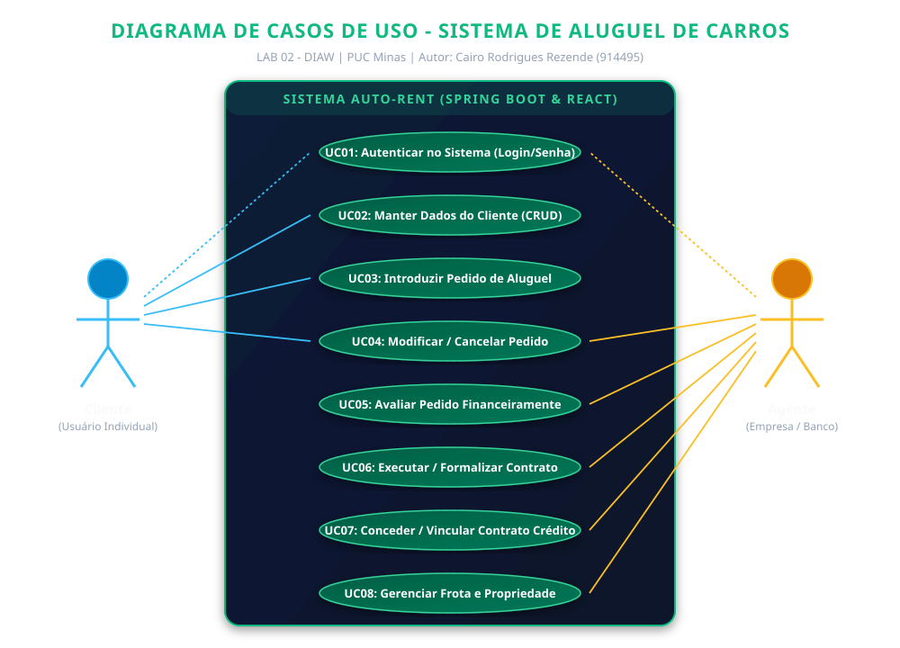
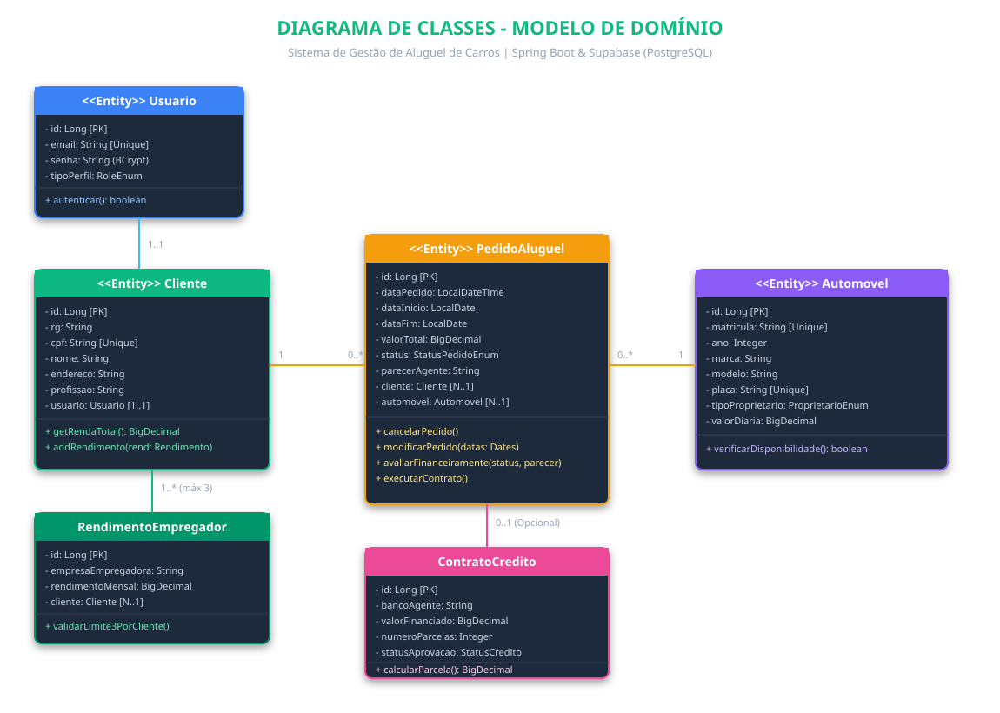
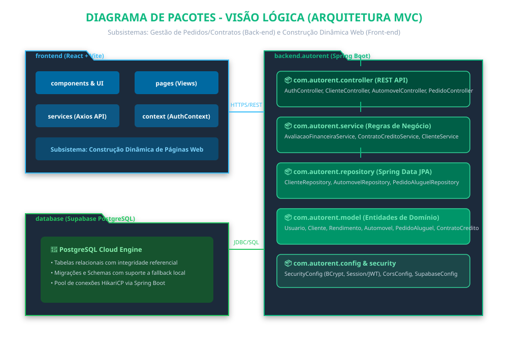
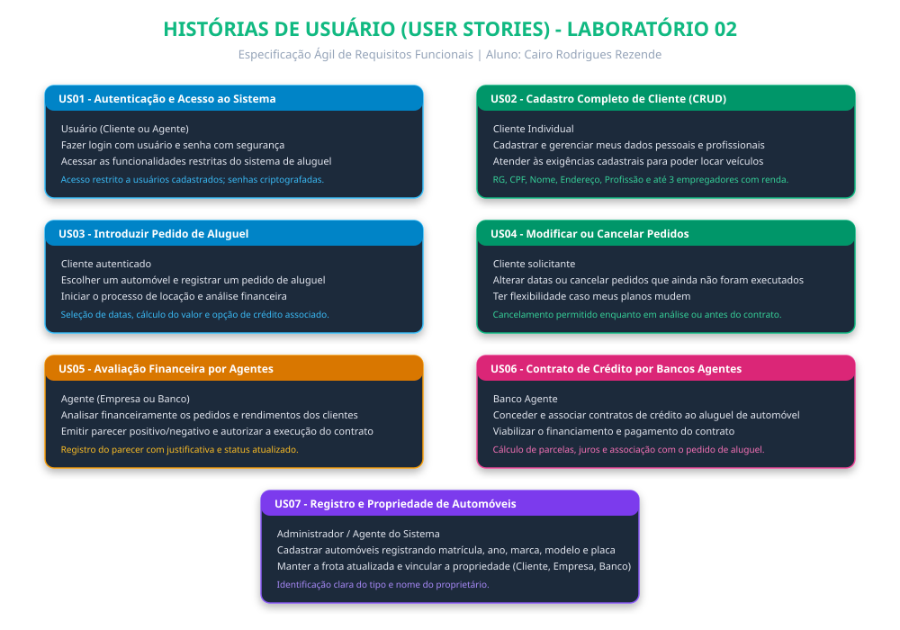

# 🏷️ Sistema de Aluguel de Carros 👨‍💻

## 🚧 Status do Projeto


---

## 📚 Índice

* [Sobre o Projeto](#-sobre-o-projeto)
* [Funcionalidades Principais](#-funcionalidades-principais)
* [Tecnologias Utilizadas](#-tecnologias-utilizadas)
* [Arquitetura](#-arquitetura)
* [Instalação e Execução](#-instalação-e-execução)
* [Estrutura de Pastas](#-estrutura-de-pastas)
* [Autores](#-autores)
* [Licença](#-licença)

---

## 🔗 Links Úteis

* **Repositório GitHub:** [https://github.com/Cairo74/LAB2_DIAW](https://github.com/Cairo74)
* **Documentação Supabase:** [https://supabase.com/docs](https://supabase.com/docs)

---

## 📝 Sobre o Projeto

Sistema desenvolvido para o **Laboratório 02** da disciplina de **Desenvolvimento e Integração de Aplicações Web (DIAW)** da **PUC Minas**.

O objetivo do sistema é permitir a gestão de aluguéis de automóveis via web. Clientes podem se cadastrar, consultar carros, fazer pedidos de aluguel, alterar ou cancelar pedidos. Agentes (empresas e bancos) têm acesso para avaliar os pedidos financeiramente, aprovar ou recusar, emitir parecer e colocar contratos em execução. O sistema também permite associar contratos de crédito concedidos por bancos agentes ao aluguel.

---

## ✨ Funcionalidades Principais

- **Autenticação:** Login obrigatório com usuário e senha para clientes e agentes (JWT).
- **CRUD de Clientes:** Cadastro completo com RG, CPF, Nome, Endereço, Profissão e até 3 entidades empregadoras com rendimentos mensais.
- **Gestão de Automóveis:** Cadastro de veículos (matrícula, ano, marca, modelo, placa) com controle de propriedade (Cliente, Empresa ou Banco).
- **Pedidos de Aluguel:**
  - Cliente introduz pedido selecionando datas e veículo.
  - Cálculo automático do valor total baseado nas diárias.
  - Opção de solicitar crédito bancário associado ao pedido.
  - Cliente pode modificar datas ou cancelar pedidos pendentes.
- **Avaliação Financeira (Agentes):**
  - Análise dos rendimentos do cliente em relação ao valor da locação.
  - Emissão de parecer financeiro (positivo/negativo).
  - Execução de contratos e aprovação de crédito por bancos agentes.

---

## 🛠 Tecnologias Utilizadas

### 💻 Front-end
* **React 18** com **Vite 6**
* **Tailwind CSS** para estilização
* **Lucide React** para ícones
* **Axios** para requisições HTTP à API REST

### 🖥️ Back-end
* **Java 25** (JDK 25)
* **Spring Boot 3.4.3**
  * Spring Web (MVC / REST API)
  * Spring Data JPA / Hibernate
  * Spring Security + JJWT (JSON Web Token)
  * Spring Validation
* **Maven** (com Maven Wrapper `mvnw`)

### ⚙️ Infraestrutura & DevOps
* **Banco de Dados:** Supabase (PostgreSQL) / PostgreSQL local
* **Banco de Desenvolvimento:** H2 Database (em memória para testes rápidos)
* **Containerização:** Docker e Docker Compose

---

## 🏗 Arquitetura

O sistema adota arquitetura MVC em camadas no back-end (Controller, Service, Repository, Model, DTO e Security) e SPA componentizada no front-end em React.

### Diagrama de Casos de Uso


### Diagrama de Classes


### Diagrama de Pacotes (Visão Lógica)


### Histórias de Usuário


---

## 🔧 Instalação e Execução

### Pré-requisitos
* Java JDK 21 ou 25 instalado
* Node.js (v18+ ou v24+) e npm instalados
* Docker Desktop (opcional, caso queira rodar via containers)

---

### 🔑 Variáveis de Ambiente

#### 1 Back-end (Spring Boot)
Por padrão, o back-end roda com banco H2 em memória sem necessidade de configuração prévia.  
Para conectar ao Supabase (PostgreSQL), configure no `backend/src/main/resources/application-supabase.properties` ou como variáveis de ambiente:

```properties
SUPABASE_DB_URL=jdbc:postgresql://<host>:5432/postgres?sslmode=require
SUPABASE_DB_USER=postgres
SUPABASE_DB_PASSWORD=<sua_senha>
```

#### 2 Front-end (React, Vite)
Arquivo `frontend/.env` (opcional, padrão `http://localhost:8080/api`):
```properties
VITE_API_URL=http://localhost:8080/api
```

---

### 📦 Instalação de Dependências

#### Front-end
```bash
cd frontend
npm install
```

#### Back-end
As dependências são baixadas automaticamente pelo Maven Wrapper na primeira execução.

---

### 💾 Inicialização do Banco de Dados (PostgreSQL)

O script SQL de criação das tabelas e carga inicial está disponível em:
[`database/schema_supabase.sql`](database/schema_supabase.sql).

Ele pode ser executado diretamente no SQL Editor do Supabase ou em qualquer banco PostgreSQL.

---

### ⚡ Como Executar a Aplicação

#### Terminal 1: Back-end (Spring Boot)
```bash
cd backend
.\mvnw.cmd spring-boot:run
```
*(No Linux/macOS: `./mvnw spring-boot:run`)*

A API estará rodando em: `http://localhost:8080`  
Console H2: `http://localhost:8080/h2-console`

#### Terminal 2: Front-end (React, Vite)
```bash
cd frontend
npm run dev
```

O front-end estará disponível em: `http://localhost:5173`

---

#### 🐳 Execução Local Completa com Docker Compose (Incluindo Banco de Dados)

Para subir o banco PostgreSQL, o back-end e o front-end simultaneamente via Docker:

```bash
docker compose up --build -d
```

Para verificar o status:
```bash
docker compose ps
```

* **Front-end:** `http://localhost:5173`
* **Back-end:** `http://localhost:8080`
* **PostgreSQL:** porta `5432`

Para encerrar:
```bash
docker compose down
```

---

## 📂 Estrutura de Pastas

```text
LAB2_DIAW/
├── backend/
│   ├── .mvn/
│   ├── mvnw
│   ├── mvnw.cmd
│   ├── pom.xml
│   ├── Dockerfile
│   └── src/
│       ├── main/java/com/autorent/
│       │   ├── config/
│       │   ├── controller/
│       │   ├── dto/
│       │   ├── model/
│       │   ├── repository/
│       │   └── service/
│       └── main/resources/
├── frontend/
│   ├── src/
│   │   ├── components/
│   │   ├── context/
│   │   ├── pages/
│   │   └── services/
│   ├── Dockerfile
│   ├── nginx.conf
│   ├── package.json
│   ├── tailwind.config.js
│   └── vite.config.js
├── database/
│   └── schema_supabase.sql
├── docs/
│   └── diagrams/
│       ├── casos_de_uso.svg
│       ├── diagrama_classes.svg
│       ├── diagrama_pacotes.svg
│       └── historias_usuario.svg
├── docker-compose.yml
├── .gitignore
└── README.md
```

---

## 👥 Autores

* **Cairo Rodrigues Rezende** — Matrícula: `914495` — GitHub: [@Cairo74](https://github.com/Cairo74)
* **Professor:** João Paulo Carneiro Aramuni — DIAW (PUC Minas)

---

## 📄 Licença

Projeto desenvolvido para fins acadêmicos na PUC Minas. Licença MIT.
